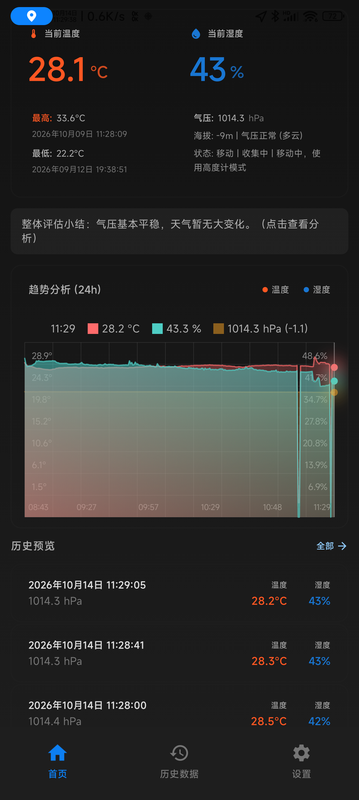
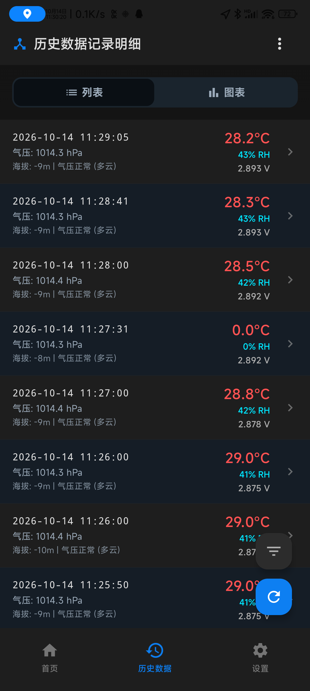
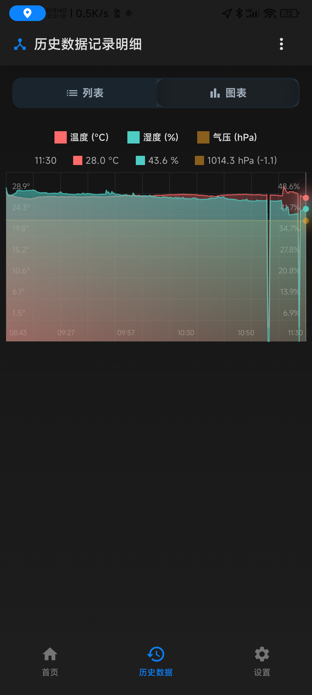
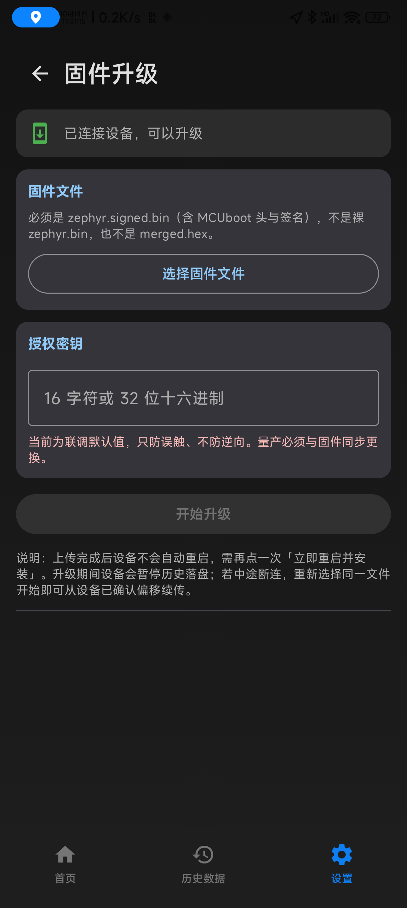

# PandaTemperature

基于 **nRF52810 + W25Q64** 的温湿度、气压记录仪，配套 Android 客户端，支持 BLE 实时读取、离线历史记录、电池电压显示和签名 OTA 升级。

本仓库统一维护固件、Android App 和硬件设计资料。

> 开发候选为 Firmware 1.0.12 / App 1.1.5（Room12），新固件尚待真机验收；下列下载与既有实证仍对应正式 v1.0.11。时间机制见[方案与边界](docs/20261016-离线时间机制.md)。

## 下载与当前版本

[下载正式版 v1.0.11](https://github.com/linckr/NRF52xxx-FieldTemp/releases/tag/v1.0.11)

| 组件 | 当前版本 |
|---|---|
| Firmware | 1.0.11+0 |
| Android App | 1.1.4，versionCode 6 |

| 你想做什么 | 使用文件 | 方法 |
|---|---|---|
| 安装 Android App | `PandaTemperature-1.1.4-release.apk` | 手机安装 |
| 已有兼容 MCUboot 的设备升级 | `zephyr.signed.bin` | Android App 的 OTA 功能 |
| 新硬件初次部署或 SWD 恢复 | `factory-merged.hex` | DAPLink / SWD，操作见开发文档 |
| 检查下载完整性 | `SHA256SUMS` | SHA-256 校验 |
| 查看产物来源和版本 | `manifest.json` | 对照发布记录与验证说明 |

发布包含 `firmware-public.pem`（MCUboot ECDSA-P256 固件验签公钥）及 `android-release-public.pem`（Android Release 公开证书）。两者用途不同，APK 证书指纹见 [Release 验证说明](docs/20261014-release-apk-device-validation.md)。`SHA256SUMS` 用于完整性核对，本身不等于独立的发布者身份认证。

OTA 镜像必须与设备 MCUboot 内嵌公钥匹配。SWD 工厂部署会更新内部 Flash，操作前应备份设备；Debug 与生产 APK 签名不同，切换前应备份 App 数据。

已发布版本仍有 [已知问题与验证边界](#验证结果与已知问题)，包括偶发 INIT22 的根因尚未确认。

## 快速开始

1. 安装生产 APK，开启手机蓝牙，并授予 App 请求的蓝牙与必要的位置权限。
2. 给温湿度计供电，在 App 中扫描并连接设备，查看实时数据及历史曲线。
3. 已部署兼容 MCUboot 的设备，可在 App OTA 页面选择 `zephyr.signed.bin` 升级；空白设备须先通过 SWD 部署工厂镜像。

升级和搬运期间保持稳定供电。签名验签通过不代表安装过程具备任意时刻断电恢复或自动回滚保证；发生启动失败时可能需要 SWD 恢复。

## 功能与硬件

- E104-BT5010A 模组（nRF52810）、W25Q64 外部 Flash、AHT30 温湿度传感器和 SPL06 气压传感器。
- BLE 实时读取温度、湿度、气压和电池电压；电压统一显示小数点后3位。
- 应用启动时唯一连接灯闪烁约3秒，未连接时熄灭，连接后常亮；MCUboot尚未进入应用时无法显示此提示。
- 模块离线采集，连接手机后同步历史记录，并在 App 中存储和展示曲线。
- 根据设备能力协商历史格式：支持扩展历史格式的固件可返回电池电压，旧格式仍按原协议解析；模块历史与手机采样分别标记。
- 支持断线重连、历史同步重试和实时数据恢复。
- 支持 BLE 固件上传、匹配镜像的断点续传与 MCUboot ECDSA-P256 验签升级；历史同步支持断线后的增量重试。

### App 实际界面

以下截图来自小米 Android 12 上运行的生产 Release App **1.1.4**，拍摄于 **2026-10-14**，使用真实设备数据。首页通过正常滚动将设备名称移出视图；OTA 页面仅展示升级入口，没有选择固件或启动升级。截图中的电压为未校准 ADC 读数。

<table>
  <tr>
    <th>实时数据与趋势</th>
    <th>历史记录与电压</th>
  </tr>
  <tr>
    <td></td>
    <td></td>
  </tr>
  <tr>
    <th>历史曲线</th>
    <th>固件 OTA 页面</th>
  </tr>
  <tr>
    <td></td>
    <td></td>
  </tr>
</table>

## 历史容量与存储策略

硬件当前有效环形容量为 **64848 条**，预留一个完整扇区用于擦除回收。容量达到上限后循环覆盖最旧记录。接线、GPIO 和存储布局见 [HARDWARE.md](HARDWARE.md)。

容量按当前页布局计算：物理记录为 12 B，每个 256 B 页容纳 21 条，每个 4 KiB 扇区容纳 `16 × 21 = 336` 条。逻辑环使用 194 个扇区，扣除 1 个擦除备用扇区，得到 `(194 − 1) × 336 = 64848` 条。History 物理区为 1 MiB，不能直接按 `1 MiB / 12 B` 推导有效容量；电压扩展返回格式也不改变物理记录长度。

对应实现见 [存储布局定义](src/storage/w25q64.h)、[逻辑环实现](src/main.c) 与 [环形回收测试](tools/history_storage_test.c)。

## OTA 架构

```text
Android App
    │ BLE 上传 zephyr.signed.bin
    ▼
nRF52810 应用 → W25Q64 secondary
    │ 安装指令与重启
    ▼
MCUboot → ECDSA-P256 验签 → 搬运到 primary → 启动应用
```

**固件可信边界是 MCUboot 验签。** `OTA_AUTH_KEY` 用于轻量操作授权与防误操作，不应视为真正的固件安全边界。

当前使用 overwrite-only 搬运模式，不提供双镜像自动回滚。OTA 只能使用 `zephyr.signed.bin`，不能用裸应用 `zephyr.bin`、工厂镜像 `merged.hex` 或 ELF 替代。详细流程见 [OTA.md](OTA.md)，报文定义见 [PROTOCOL.md](PROTOCOL.md)。

ECDSA 验签拒绝不受信任密钥签署的镜像；是否阻止旧版本回滚或固件降级，还取决于独立的版本保护配置，不能仅凭签名推断。

## 仓库结构

```text
.
├─ src/                  固件、传感器、存储与 BLE 实现
├─ boards/               模组硬件 overlay
├─ sysbuild/             MCUboot 构建配置
├─ tools/                构建、容量检查与回归工具
├─ android/              Android Gradle 工程
├─ PCB/                  PCB 与 BOM
├─ 3DModel/              外壳设计
├─ docs/                 开发计划与专题验证记录
├─ VERSION               固件版本唯一来源
├─ app.overlay           应用设备树 overlay
├─ prj.conf              应用 Kconfig
├─ sysbuild.conf         系统构建配置
├─ pm_static.yml         静态 Flash 分区
├─ CMakeLists.txt         固件构建入口
└─ CODEX_START_HERE.md    工程接手入口
```

**本统一仓库的 `android/` 是 Android 唯一日常开发入口。** [Android 独立仓库](https://github.com/linckr/PandaThemperature-Android) 的 `source/` 通过受控同步维护，保留用于提交原 Android 上游 PR；不应在两处独立修改后无记录地双向覆盖。

涉及协议的贡献优先提交到本统一仓库，同时检查两端实现；维护者将配套修改同步到独立仓库，再分别更新 Firmware 和 Android 上游 PR。旧 `README.rst` 仅作为历史入口，当前项目介绍以本文件为准。

## 快速构建

### Firmware

使用 **nRF Connect SDK 3.2.1** 及其配套工具链。构建目标为 `nrf52dk/nrf52810`，通过工程 overlay 描述实际模组硬件。

按 `src/ble/ota_auth_key.h.example` 配置本地授权文件，并准备仓库外的 ECDSA-P256 签名私钥。在 NCS 环境中，从仓库根目录执行：

```powershell
python tools/build_sysbuild.py --signing-key "<仓库外私钥路径>" build-production
python tools/size_summary.py build-production --quiet
python tools/release_gate.py build-production --quiet
```

SWD 初始部署使用 `build-production/merged.hex`；OTA 使用 `build-production/NRF52xxx-FieldTemp/zephyr/zephyr.signed.bin`。DAPLink / pyOCD 连接、烧录与完整环境配置见 [DEVELOPMENT.md](DEVELOPMENT.md)。

自行生成的私钥不能签出已有生产 MCUboot 接受的镜像；自建信任根需要部署对应公钥的 MCUboot。

### Android

使用 **JDK 17、Android SDK 36、Gradle Wrapper 8.13**，最低支持 Android 8.0 / API 26。

从 `android/` 执行：

```powershell
.\gradlew.bat :app:assembleDebug
```

生产 Release 使用仓库外签名配置：

```powershell
$env:PANDA_RELEASE_KEYSTORE_PROPERTIES = "<仓库外 keystore.properties 路径>"
.\gradlew.bat :app:assembleRelease :app:lintRelease
```

生产发布必须提供正式签名配置，并核对 APK 证书 SHA-256 指纹。当前源码已禁止缺配置时回退 Debug，并拒绝使用 Android Debug 证书构建 Release；日常测试使用 `assembleDebug`。配置模板见 [android/README.md](android/README.md)。

## Flash 分区与资源

| 存储 | 区域 | 地址范围（左闭右开） | 大小 |
|---|---|---|---|
| nRF52810 | MCUboot | `0x00000–0x08000` | 32 KiB |
| nRF52810 | Primary，含镜像头 | `0x08000–0x30000` | 160 KiB |
| W25Q64 | Secondary | `0x000000–0x028000` | 160 KiB |
| W25Q64 | NVS | `0x028000–0x02E000` | 24 KiB |
| W25Q64 | History | `0x02E000–0x12E000` | 1 MiB |

当前正式构建：

| 项目 | 静态已用 / 可用 | 静态余量 |
|---|---|---|
| App Flash | 151700 / 163328 B | 11628 B |
| App RAM | 23016 / 24576 B | 1560 B |
| MCUboot Flash | 31876 / 32768 B | 892 B |

以上为链接时静态资源占用，不代表运行时栈余量或堆使用情况；OTA、BLE 和 Flash 操作的栈高水位及运行时资源仍需独立验证。签名镜像为 152362 B，完整 Primary 槽剩余 11478 B；这与表中的裸 App 分区余量口径不同。新增功能前必须重新评估资源。

## 验证结果与已知问题

截至 **2026-10-14**：

- 生产 MCUboot 公钥已部署，独立电池冷启动与连接恢复通过。
- 生产签名 OTA 已实际安装并完整回读主槽确认，该历史批次设备恢复 `1.0.10+0`；当前 `1.0.11+0` 经 SWD 主槽完整回读和独立电池冷启动验证。
- 生产 Release APK 已在小米 Android 12 / API 31 安装，实际 APK 与发布产物完整哈希一致。
- Release 真机回归通过初次连接、连续全量同步、同步中断后的数据保留、重连、增量重试和实时恢复；签名切换后的数据库与设置恢复核对通过。
- 固件环形存储回归、123 项 JVM 测试、9 项 Room / 迁移测试及 Release lint 通过。

仍待完成：偶发初始化错误 **22** 的实际失败取证与根因确认、电池电压 ADC 校准、Android 13 及以上权限行为与长期运行验证，以及 NOR / NVMC 实际忙脉冲期间的精确断电验证。已有 P3 阶段断电恢复测试不能替代忙脉冲验证。

本轮1.0.11/1.1.4配对Live73.935 s通过，上电提示和连接/断连灯行为均由用户实物确认。测试辅助APK已移除，不会持续重复全量同步。手机来源仍有少量零温湿度采样，需单独排查；未改动或删除这些原始数据。

本轮证据见 [上电与三位电压验收](docs/20261014-startup-voltage-validation.md)。历史证据见 [Release APK 真机验收](docs/20261014-release-apk-device-validation.md) 和 [生产部署与 INIT22 诊断](docs/20261014-production-deployment-diagnosis.md)。[v1.0.11 发布记录](https://github.com/linckr/NRF52xxx-FieldTemp/releases/tag/v1.0.11) 中的 `manifest.json`、`SHA256SUMS` 记录对应提交及产物哈希；[1.0.10验收提交](https://github.com/linckr/NRF52xxx-FieldTemp/commit/bf2a759372c99b076984de2731ae446d3ecc637f) 保存历史正式 APK 验收说明。仅本地构建通过的其他提交，不自动继承这份真机结论。

## 开发与交接

| 文档 | 内容 |
|---|---|
| [CODEX_START_HERE.md](CODEX_START_HERE.md) | 接手入口与当前状态 |
| [HANDOFF.md](HANDOFF.md) | 验证证据、风险及剩余任务 |
| [DEVELOPMENT.md](DEVELOPMENT.md) | 构建、烧录与开发流程 |
| [HARDWARE.md](HARDWARE.md) | 硬件接线、GPIO 与 Flash 布局 |
| [PROTOCOL.md](PROTOCOL.md) | Firmware 与 Android 的 BLE / OTA 协议 |
| [OTA.md](OTA.md) | 签名、升级架构与操作说明 |

当前代码是最终事实源。协议改动必须同时检查 Firmware 和 Android；不要随意更改 Flash 分区、BLE UUID、OTA 报文、签名算法或 MCUboot 配置。

签名私钥、Android keystore、OTA 凭据和用户数据库不得进入 Git 或公开发布资产。

## 许可与致谢

本项目基于 [yodfz/NRF52xxx-FieldTemp](https://github.com/yodfz/NRF52xxx-FieldTemp) 与 [yodfz/PandaThemperature-Android](https://github.com/yodfz/PandaThemperature-Android) 继续开发，感谢原作者的固件、客户端与硬件设计工作。本项目增加了统一工程维护、历史电压、同步与重连保护、生产签名部署和真机验证记录。

截至本次核对，统一仓库没有独立 `LICENSE` 文件，GitHub 也未识别两个上游仓库的许可证。源码、PCB 与外壳模型的许可范围仍需分别核实；本 README 不新增或代替原作者的授权。Zephyr、MCUboot 和 Android 依赖保留各自许可证。


## 冷启动离线使用注意

当前版本重新装入电池后，应先连接App完成本次上电的时间同步，再断开用于离线记录。上电闪烁只表示程序开始启动，不保证Flash/传感器初始化或可信时间已恢复。断电后NVS保存的旧对时时间不能反映停机经过时长，未对时的记录可能显示在旧日期；详情与已知问题见[接手入口](CODEX_START_HERE.md)。10月15日骑行异常正在保全原始数据诊断，不能据App界面未显示就断言硬件没采样。
